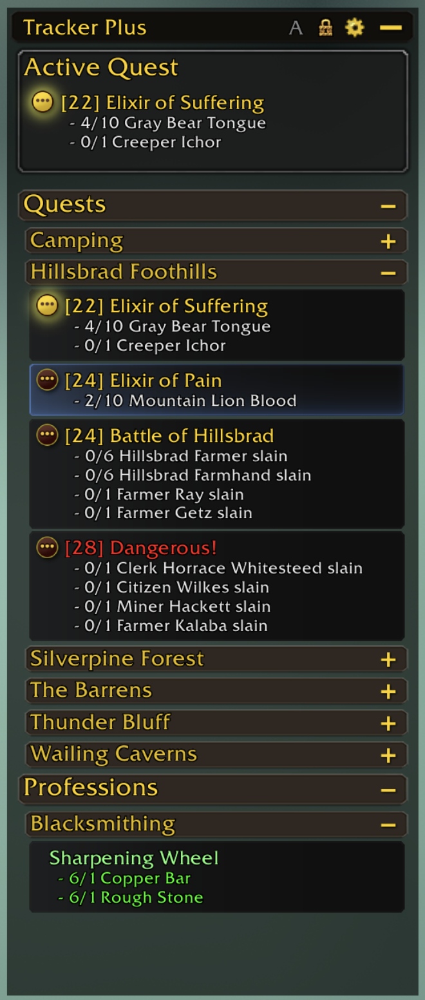
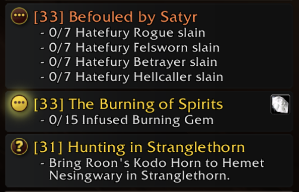
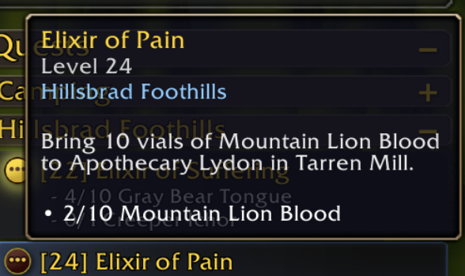
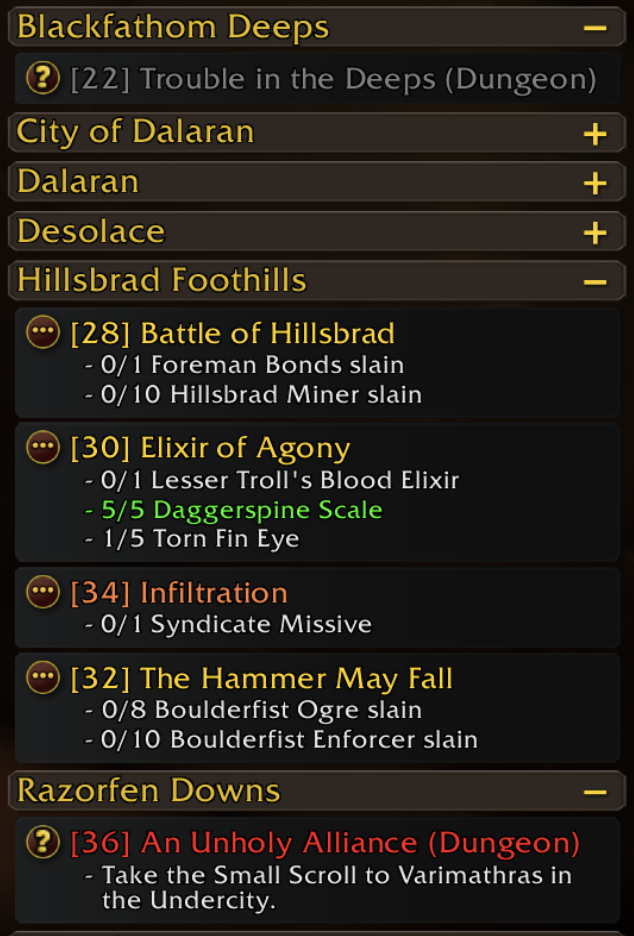

# TrackerPlus

A replacement for World of Warcraft's objective tracker. Quests are colored by difficulty, the world map's quest pins match those colors, the quest whose area you're standing in is marked, and enemies your quests need are highlighted on their nameplates.

Works on Retail and on WoW Forever. Features that Forever doesn't have (campaigns, world quests, achievements and so on) are switched off there and left out of the settings.

<!-- SCREENSHOT: docs/screenshots/hero.png
     The tracker in a busy zone: several zone headers, difficulty-colored quests, the Active Quest section and a quest-area marker.

-->

## Contents

- [Getting started](#getting-started)
- [The tracker](#the-tracker)
  - [Sections](#sections)
  - [Quest rows](#quest-rows)
  - [Quest colors](#quest-colors)
  - [Quest area marker](#quest-area-marker)
  - [Zone headers and auto-minimize](#zone-headers-and-auto-minimize)
  - [Clicking](#clicking)
  - [Title bar](#title-bar)
  - [Position and size](#position-and-size)
- [World map pins](#world-map-pins)
- [Nameplate highlights](#nameplate-highlights)
- [Settings](#settings)
- [Slash commands](#slash-commands)
- [Optional addons](#optional-addons)
- [Installation](#installation)
- [For developers](#for-developers)

## Getting started

1. Install the addon (see [Installation](#installation)) and log in.
2. TrackerPlus takes the place of the game's own tracker, at the same spot and size.
3. Type `/tp` to open the settings, or click the gear on the tracker's title bar.

## The tracker

### Sections

Each kind of content gets its own section, top to bottom:

| Section | Version(s) | What's in it |
| --- | --- | --- |
| **Quest popups** | Retail | Auto-accept and auto-complete quest popups. Click one to accept or turn in. |
| **Scenario** | Retail | The current scenario, delve or dungeon objectives. |
| **Active Quest** | Retail, Forever | The quest you're focused on (super-tracked). |
| **Follow the Arrow** | Retail | The current step of a [FollowTheArrow](#optional-addons) guide. Off by default. |
| **Campaign** | Retail | Campaign quests. |
| **Bonus Objectives** | Retail | Area bonus objectives you're working on. |
| **World Quests** | Retail | Tracked and in-progress world quests. |
| **Quest Timers** | Retail, Forever | Countdowns for timed quests, just above the quest list. Click one to make it your Active quest. |
| **Quests** | Retail, Forever | All other tracked quests, grouped under zone headers. |
| **Achievements** | Retail | Tracked achievements and their criteria. |
| **Professions** | Retail, Forever | Tracked recipes and their reagents. |
| **Monthly Activities** | Retail | Tracked Trading Post / Traveler's Log activities. |
| **Endeavors** | Retail | Tracked housing endeavors. |

Each type can be turned off under **Settings → Tracking Panel**. A campaign quest that is also your Active quest can be shown in both sections (**Campaign in Active Quest** on the main settings page).

<!-- SCREENSHOT: docs/screenshots/sections.png
     A tall tracker showing as many sections as possible at once (Scenario, Active Quest, Campaign, World Quests, Quests, Achievements, Professions).

-->

<!-- SCREENSHOT: docs/screenshots/quest-popup.png
     An auto-accept or auto-complete popup sitting at the top of the tracker.

-->

<!-- SCREENSHOT: docs/screenshots/quest-timer.png
     A Quest Timer row counting down above the quest list.

-->

### Quest rows

Each quest row has:

- The game's own **map pin button** on the left. Click it to focus that quest, or to stop focusing it.
- The **quest level** before the name, e.g. `[28+]` for a group quest (**Show Quest Level**).
- **Objectives** underneath, turning green when done and red when failed, with **progress bars** for percentage objectives.
- A **quest item button** when the quest has a usable item. Click it to use the item, the same as on the game's tracker.
- A **Find a Group** button on quests that have one.
- A **tooltip** on hover with the quest's level, zone and objectives (**Show Tooltips**).

An optional **row background** can be drawn behind each row (**Settings → Appearance → Row Styling**).

<!-- SCREENSHOT: docs/screenshots/quest-row.png
     Close-up of one or two quest rows: map pin button, level, objectives, a progress bar and a quest item button.

-->

<!-- SCREENSHOT: docs/screenshots/quest-tooltip.png
     The hover tooltip on a quest row.

-->

### Quest colors

- **By difficulty.** Quest names are colored gray, green, yellow, orange or red the same way the quest log colors them. The game decides how hard each quest is for you, so scaling quests get the right color. Turn **Color by Difficulty** off to use one flat quest color instead.
- **Focused quest.** The quest you're focused on is always gold.
- **Other content.** Achievements, professions, monthly activities, endeavors, scenarios and bonus objectives each have their own color, set under **Settings → Appearance → Colors**.

<!-- SCREENSHOT: docs/screenshots/difficulty-colors.png
     A zone with quests of several difficulties (gray, green, yellow, orange, red) and the gold focused quest.

-->

### Quest area marker

While you're inside the shaded area the map draws for a quest, that quest's row is marked. Pick a style and a color under **Settings → Appearance → Quest Area Highlight**:

- Stripe (Left) or Stripe (Right)
- Bracket
- Outline
- Background Tint
- Gradient Fade (Left) or Gradient Fade (Right)
- Friend Card (Battle.net) or Friend Card (Selected)

<!-- SCREENSHOT: docs/screenshots/quest-area-styles.png
     A grid of the same quest row in each marker style.

-->

### Zone headers and auto-minimize

Quests are grouped under zone headers, and every section has its own header. Click a header to collapse or expand it. Shift-click a section header to collapse or expand all of its zone groups at once.

**Auto-minimize** (the **A** button on the title bar) keeps only your current zone, and any zone whose quest area you're standing in, expanded. Everything else collapses, and opens again when you get there. Collapsing or expanding a zone header yourself turns auto-minimize off.

The expand/collapse icon's style and side, and the header background, are set under **Settings → Appearance → Header Styling**.

<!-- SCREENSHOT: docs/screenshots/auto-minimize.png
     Before/after: many zone headers expanded, then auto-minimize on with only the current zone open.

-->

<!-- SCREENSHOT: docs/screenshots/header-styles.png
     The header icon styles (Standard, Square, Text, Quest Log) and header backgrounds side by side.

-->

### Clicking

| On a… | Click | Shift-click | Right-click |
| --- | --- | --- | --- |
| Quest | Open the map to it, scrolling the quest log to it and highlighting it | Link it in chat | Menu: Focus Quest, Stop Tracking, Show in Quest Log, Share Quest (in a group), Link to Chat, Abandon Quest |
| Quest popup | Accept or turn in the quest | — | — |
| Quest timer | Make it your Active quest | — | — |
| World quest / bonus objective | — | Link it in chat | — |
| Achievement | Open it in the Achievements window | Link it in chat | Menu: Link to Chat, Stop Tracking |
| Recipe | Open it in your profession window | Link it in chat | Menu: Link to Chat, Stop Tracking |
| Monthly activity | Open the Traveler's Log | Link it in chat | Menu: Link to Chat, Stop Tracking |
| Endeavor | Open it in the housing window | Link it in chat | Menu: Link to Chat, Stop Tracking |

The mouse wheel scrolls the tracker; there's no visible scrollbar.

<!-- SCREENSHOT: docs/screenshots/quest-menu.png
     The right-click menu on a quest.

-->

### Title bar

From right to left, the title bar buttons are:

| Button | Does |
| --- | --- |
| **Minimize** | Shrinks the tracker to a single button in the same spot. Click it again to bring the tracker back. |
| **Settings** (gear) | Opens the settings. |
| **Lock** (padlock) | Locks or unlocks the frame. |
| **A** | Turns [auto-minimize](#zone-headers-and-auto-minimize) on (gold) or off (gray). |
| **Arrow** | Turns the [Follow the Arrow](#optional-addons) section on (gold) or off (gray). Only shown when FollowTheArrow is loaded. |

<!-- SCREENSHOT: docs/screenshots/title-bar.png
     Close-up of the title bar with all five buttons, plus the minimized single-button state.

-->

### Position and size

On first load TrackerPlus sits exactly where the game's own tracker is, at the same size, and follows any changes you make to that tracker in Edit Mode (**Match Game Tracker**). While Edit Mode is open, TrackerPlus steps aside so you can grab the game's tracker.

To place it yourself, unlock the frame, drag the title bar to move it and drag a bottom corner to resize it. Match Game Tracker turns itself off the moment you do; check it again to snap back. **Anchor** picks which point of the tracker stays put as it grows and shrinks.

The tracker can also be hidden in instances, in combat, or while nothing is tracked.

<!-- SCREENSHOT: docs/screenshots/panel-styles.png
     The tracker with a few different background and border textures (e.g. Solid, Blizzard Tooltip, Blizzard Dialog Gold, Parchment).

-->

## World map pins

The game's own quest pins on the world map get a ring in the same color as that quest's name in the tracker, so the map and the tracker always agree. Choose a soft **Glow** or a solid **Circle**, and set its thickness and, for the glow, its opacity. These are under **Settings → Map Pins**.

<!-- SCREENSHOT: docs/screenshots/map-pins.png
     The world map with several quest pins ringed in different difficulty colors.

-->

<!-- SCREENSHOT: docs/screenshots/map-pin-styles.png
     Close-up comparing the Glow and Circle styles on the same pin.

-->

## Nameplate highlights

Enemy nameplates are highlighted when that enemy is something your quests need. The game's own unit tooltip decides what counts, so the highlights match what the game considers a quest target.

| Highlight | Version(s) | Used for | Default color |
| --- | --- | --- | --- |
| **Current Target** | Retail, Forever | Your target, when it's also a quest target | Green |
| **Active Quest Target** | Retail, Forever | Targets for your Active (focused) quest. Takes priority over the quest highlights below. | Blue |
| **Quest Objective Target** | Retail, Forever | Enemies you need to kill for a quest | Yellow |
| **Quest Item Target** | Retail, Forever | Enemies that drop an item you need for a quest, even when killing them isn't an objective | Cyan |
| **World Quest Objective Target** | Retail | Targets for active world quests | Blue |
| **Bonus Objective Target** | Retail | Targets for area bonus objectives | Pink |

When you target an enemy that isn't a quest target, the game's normal target border is shown instead.

Each highlight can be turned on or off on its own and has its own style, color, thickness and offset. The styles are **Blizzard** (the game's own target border, the default), **Outline**, **Glow** and **Rounded**.

There are also options to hide the game's target border on the health bar or on the level badge, or to redraw it 1px lower so it sits evenly around the health bar.

The settings page has a **preview nameplate**. Click the magnifying glass next to a highlight to see it on the preview before you go out into the world.

<!-- SCREENSHOT: docs/screenshots/nameplates-world.png
     A group of enemies in the world with quest objective, quest item and current target highlights visible at once.

-->

<!-- SCREENSHOT: docs/screenshots/nameplate-styles.png
     The same nameplate in each style: Blizzard, Outline, Glow, Rounded.

-->

<!-- SCREENSHOT: docs/screenshots/nameplates-settings.png
     The Nameplates settings page with the preview nameplate.

-->

## Settings

Type `/tp`, click the gear on the title bar, or open **Game Menu → Options → AddOns → TrackerPlus**. The settings are split into pages:

| Page | What's on it |
| --- | --- |
| **TrackerPlus** | Turn the tracker on or off, lock it, show tooltips; hide it in instances, in combat or when empty; Campaign in Active Quest and Follow the Arrow; reset all settings. |
| **Tracking Panel** | Show quest level, color by difficulty, sort order, and which content types to show. Sort order can be by difficulty (easiest or hardest first), by proximity, or alphabetical. |
| **Nameplates** | Everything under [Nameplate highlights](#nameplate-highlights). |
| **Appearance** | Match Game Tracker, anchor, width, height and scale; background and border textures and colors; header icon and background; row background; quest area marker; progress bar border and texture; fonts and sizes for headers, quest names and objectives; colors for text and each content type. |
| **Layout** | Indents and spacing. |
| **Map Pins** | Everything under [World map pins](#world-map-pins). |
| **Debug** | Logging and layout overlays, for troubleshooting. |

Background, border, progress bar and font lists include anything other addons have registered with LibSharedMedia.

<!-- SCREENSHOT: docs/screenshots/settings-main.png
     The main TrackerPlus settings page.

-->

<!-- SCREENSHOT: docs/screenshots/settings-appearance.png
     The Appearance settings page.

-->

## Slash commands

| Command | Does |
| --- | --- |
| `/tp` or `/trackerplus` | Open settings |
| `/tp toggle` | Turn the tracker on or off |
| `/tp lock` / `/tp unlock` | Lock or unlock the frame |
| `/tp reset` | Reset all settings to their defaults |
| `/tp nameplates` | Open the Nameplates settings page |
| `/tp nameplates toggle` | Turn nameplate highlights on or off |
| `/tp nameplates debug` | Show or hide the nameplate debug window |

## Optional addons

- **[FollowTheArrow](https://www.curseforge.com/wow/addons/followthearrow)**: when it's loaded, TrackerPlus can show the current guide step in its own section, between Active Quest and Campaign. Turn it on with the arrow button on the title bar or on the main settings page.
- **Auctionator**: its crafting search button is moved into the Professions section.
- **LibSharedMedia** (bundled with many addons): its textures and fonts show up in the Appearance lists.

<!-- SCREENSHOT: docs/screenshots/follow-the-arrow.png
     The Follow the Arrow section showing a guide step.

-->

## Installation

1. Copy the `TrackerPlus` folder into your game's `Interface\AddOns\` folder, for example `World of Warcraft\_retail_\Interface\AddOns\`.
2. Restart the game, or type `/reload`.

Settings are saved per account in `TrackerPlusDB`. Settings from the standalone NextTarget nameplate addon are imported the first time TrackerPlus loads.

## For developers

| Folder / file | What it does |
| --- | --- |
| `Database.lua` | Default settings, saved-variable migrations and Retail/Forever restrictions |
| `Core.lua` | Events, the update loop, Edit Mode handling and slash commands |
| `Data/` | Collects quests, achievements and other trackables; parses objectives, picks quest colors and sorts trackables |
| `Render/` | Draws each tracker section; `TrackerRenderer.lua` lays them out |
| `UI/` | The tracker frame, title bar, button pools, click handling, auto-minimize, panel textures and Match Game Tracker |
| `Map/` | World map pin colors and the quest area marker |
| `Nameplates/` | Nameplate highlights, their settings page and debug window |
| `Settings.lua`, `SettingsWidgets.lua` | The settings pages and their controls |
| `DebugFrame.lua` | The debug log window |

### Adding screenshots

Screenshot slots are HTML comments in this file, each starting with `SCREENSHOT:` and naming a path under `docs/screenshots/` plus what to capture. To fill one, save the image at that path and remove the comment markers around its `![...]` line.

## Credits

Created by **jr0dsgarage**. All rights reserved; for personal use only.
